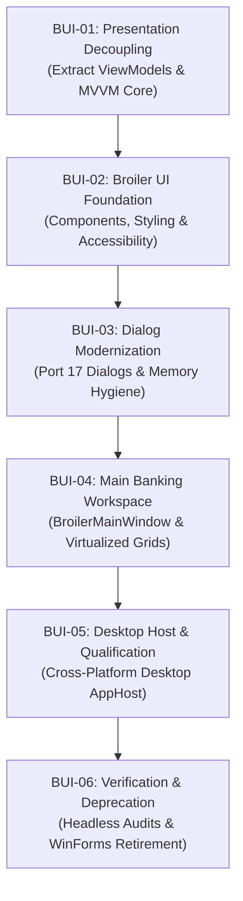

# Broiler Fond — Roadmap: Migration from Windows Forms to Broiler UI

- **Brand:** Broiler
- **Product:** Fond - Finance on Demand
- **Technical name:** `Broiler.Fond`
- **Component Track:** Presentation & UI Modernization (`Broiler.UI` / `Broiler.Fond.Presentation`)
- **Source Architecture:** `Broiler.Fond.Host.Windows` (`System.Windows.Forms`, WinForms on `net10.0-windows`)
- **Target Architecture:** `Broiler.UI` + `Broiler.Fond.Presentation` + `Broiler.Fond.Host.Desktop` (Cross-platform desktop on `net10.0`)
- **Status:** Complete — All Phases (BUI-01 through BUI-06) Fully Delivered, Verified & WinForms Retired
- **Last updated:** 2026-10-20

> **Functional integration follow-up (2026-10-21):** Completion of the UI migration
> does not establish live-bank compatibility. Both refresh actions now share a
> deterministically tested workflow; bank procedure acquisition/selection and
> signed SCA remain incomplete. See the [balance refresh roadmap](balance-refresh-roadmap.md)
> and [BR-09 qualification record](bank-refresh-qualification.md).

---

## 1. Executive Summary & Strategic Rationale

Broiler Fond - Finance on Demand was initially designed with a Windows-first desktop delivery ([Milestone 1](milestone-1.md) through [Milestone 7](milestone-7.md)), utilizing standard Windows Forms (`System.Windows.Forms`) for the first interactive client shell (`Broiler.Fond.Host.Windows`). This pragmatic decision allowed rapid qualification of the core banking kernel, storage cryptography, and FinTS protocol engine while maintaining a strictly bounded Windows environment.

However, the product architecture has reached the milestone threshold where Windows Forms becomes a strategic bottleneck:
1. **Platform Lock-In:** Windows Forms is inextricably bound to Windows Win32 APIs and the Windows Desktop SDK (`net10.0-windows`). It cannot execute on Linux or macOS desktop hosts, directly blocking the cross-platform vision defined in [Milestone 8](milestone-8.md) ([ADR 0130](adr/0130-cross-platform-host-seam-and-platform-qualification.md) and [ADR 0134](adr/0134-cross-host-distribution-pipeline-and-multi-platform-ci.md)).
2. **Legacy Rendering & High-DPI Fragility:** WinForms relies on legacy GDI+ and User32 window handles (`HWND`), requiring complex manual DPI scaling overrides, lacking native dark mode on older Windows builds, and lacking GPU-accelerated smooth canvas composition.
3. **Coupled Presentation Logic:** In the current host, presentational state and view logic are partially coupled to WinForms control hierarchies (`MainForm.cs` exceeds 2,000 lines), making headless cross-platform testing and UI modernization harder to maintain.
4. **Memory Hygiene Challenges:** WinForms controls (`TextBox`) internally use managed `System.String` for text storage, creating immutable heap allocations during passphrase, PIN, and TAN input that cannot be deterministically zeroed out with `CryptographicOperations.ZeroMemory`.

### The Solution: "Broiler UI"
**Broiler UI** is the first-party, cross-platform UI component library and presentation framework designed specifically for the Broiler product ecosystem. It provides:
- **True Cross-Platform Desktop Support:** One unified presentation stack executing natively across Windows (10/11), Linux (Wayland/X11), and macOS (Metal/Cocoa) on standard `net10.0`.
- **Pure BCL & Zero Telemetry:** Built from the ground up without third-party telemetry, cloud dependencies, or unvetted external runtime packages.
- **Deterministic Ephemeral Credential Hygiene:** Custom secure text entry primitives backed by pinned native character/byte buffers that are deterministically wiped upon dialog dismissal.
- **Strict Accessibility Compliance:** Native implementation of European Accessibility Act (BFSG / EN 301 549) and WCAG 2.1 AA requirements with an automated, headless accessibility auditor.
- **Full Trimming & Native AOT Compatibility:** Unidirectional data flow and compiled bindings that require zero dynamic code generation, zero reflection, and emit zero IL2026/IL2091 trimming warnings.

---

## 2. Target Architecture & Layering Model

The migration cleanly decouples presentation logic into three distinct architectural layers, preserving the inviolable BCL-only kernel boundary:

```text
+-------------------------------------------------------------------------------+
|                             Operating System Shells                           |
|       Windows (Win32/DWM)    |     Linux (Wayland/X11)    |    macOS (Cocoa)  |
+-------------------------------------------------------------------------------+
                                        |
+-------------------------------------------------------------------------------+
|                         Broiler.Fond.Host.Desktop                             |
|  - Native window lifecycle & window chrome management                         |
|  - System tray, notifications, clipboard integration (ADR 0130 Seams)         |
|  - Host Platform Qualification preflight (AesGcm, Unicode, Invariant culture) |
+-------------------------------------------------------------------------------+
                                        |
+-------------------------------------------------------------------------------+
|                                 Broiler.UI                                    |
|  - Cross-platform UI component system (controls, layouts, themes)             |
|  - Reactive canvas & retained-mode compositor (GPU-accelerated)               |
|  - BroilerSecureTextBox (pinned-buffer memory hygiene for PIN/TAN)           |
|  - High-performance VirtualizedDataGrid (100k transactions < 16ms render)     |
|  - BFSG / WCAG 2.1 AA Accessibility Automation Tree & focus management        |
+-------------------------------------------------------------------------------+
                                        |
+-------------------------------------------------------------------------------+
|                          Broiler.Fond.Presentation                            |
|  - Platform-neutral ViewModels (AccountViewModel, TransactionViewModel, etc.)|
|  - Application State & Session Coordinators (HostSession, SafeMode)           |
|  - Dialog & Navigation Contracts (IDialogService, INavigationService)         |
|  - Localization catalog bindings (de-DE / en-US)                              |
+-------------------------------------------------------------------------------+
                                        |
+-------------------------------------------------------------------------------+
|                     Broiler.Fond.Kernel (net10.0 shared framework)            |
|  - Pure BCL-only banking domain, FinTS 3.0/4.1, EBICS, ISO 20022              |
|  - AES-256-GCM / PBKDF2 encrypted profile store (store-v1.xsd)                |
|  - Monotonic 64-bit LocalIdentityLedger & exact Money arithmetic              |
|  - ZERO UI dependency, ZERO platform dependency, ZERO third-party NuGet      |
+-------------------------------------------------------------------------------+
```

---

## 3. Surface Area Inventory & Migration Matrix

The existing Windows Forms implementation in `Broiler.Fond.Host.Windows` consists of **1 Main Form (`MainForm.cs`)**, **17 Dialogs**, **6 ViewModels**, and **2 Self-Test/Accessibility verification engines**. Every element is mapped to its Broiler UI successor:

| Category | Windows Forms Source (`Broiler.Fond.Host.Windows`) | Broiler UI Target (`Broiler.UI` / `Presentation`) | Key Architectural Improvements |
| :--- | :--- | :--- | :--- |
| **Main Shell** | `Views/MainForm.cs` (2,091 lines, GDI+) | `BroilerMainWindow` | Modern tab strip, responsive fluid layout, theme switching, high-DPI crisp vector rendering |
| **Accounts** | `TabPage _tabAccounts`, `ListView _lstAccounts` | `AccountsView` + `BroilerVirtualDataGrid` | Multi-currency partitioned cards, balance freshness badges, inline account actions |
| **Transactions** | `TabPage _tabTransactions`, `ListView _lstTransactions` | `TransactionsView` + `BroilerVirtualDataGrid` | Virtualized rendering of 100,000+ items, instant search filter (< 300ms p95), column sorting |
| **Insights** | `TabPage _tabInsights`, `ListView _lstBudgets` | `InsightsView` + `BroilerChart` | Responsive cash-flow timeline visualization, category budget progress bars, net-worth cards |
| **Connections** | `TabPage _tabConnections`, `ListView _lstConnections` | `ConnectionsView` + `BroilerCardList` | Connection status badges, instant synchronization triggers, clear quarantine indicators |
| **Security** | `TabPage _tabSecurity`, `RichTextBox _txtAuditLog` | `SecurityAuditView` | Cryptographic hash-chained audit log viewer, Safe Mode toggle with visual warning banner |
| **Dialog 01** | `Dialogs/ProfileUnlockDialog.cs` | `BroilerProfileUnlockDialog` | Secure passphrase input, visual PBKDF2 calibration progress, lockout countdown |
| **Dialog 02** | `Dialogs/InstitutionSetupDialog.cs` | `BroilerInstitutionSetupDialog` | Real-time HTTPS URL validation, separated ASCII host badge, bank identifier lookup |
| **Dialog 03** | `Dialogs/EndpointConfirmationDialog.cs`| `BroilerEndpointConfirmationDialog`| Prominent phishing alert callout, independent host verification checkbox |
| **Dialog 04** | `Dialogs/CredentialPromptDialog.cs` | `BroilerCredentialPromptDialog` | `BroilerSecureTextBox` with pinned memory buffer, auto-zeroing on close/cancel |
| **Dialog 05** | `Dialogs/ScaChallengeDialog.cs` | `BroilerScaChallengeDialog` | Multi-mode visual renderer (Flicker code, PhotoTAN matrix, QR code, push polling indicator) |
| **Dialog 06** | `Dialogs/PaymentInitiationDialog.cs` | `BroilerPaymentInitiationDialog` | Dynamic IBAN validation, exact decimal amount entry, execution mode selector |
| **Dialog 07** | `Dialogs/PaymentReviewDialog.cs` | `BroilerPaymentReviewDialog` | Verification of Payee (VoP) status badge, bank warning disclosure box, dual-review trigger |
| **Dialog 08** | `Dialogs/StandingOrdersDialog.cs` | `BroilerStandingOrdersDialog` | Periodicity cadence selector, execution calendar preview, deletion confirmation |
| **Dialog 09** | `Dialogs/DirectDebitReturnDialog.cs` | `BroilerDirectDebitReturnDialog` | Official SEPA return reason selector (AM04, MD01, etc.), 8-week refund deadline notice |
| **Dialog 10** | `Dialogs/AccountRelinkingDialog.cs` | `BroilerAccountRelinkingDialog` | Side-by-side account candidate comparison, provenance-preserving purge preview |
| **Dialog 11** | `Dialogs/ConnectionRemovalDialog.cs` | `BroilerConnectionRemovalDialog` | High-impact warning modal, choice between config removal vs full privacy purge |
| **Dialog 12** | `Dialogs/SupportExportDialog.cs` | `BroilerSupportExportDialog` | SHA-256 preview digest badge, searchable redacted JSON/text viewer, save-as picker |
| **Dialog 13** | `Dialogs/CsvExportDialog.cs` | `BroilerCsvExportDialog` | Date range picker, column selector checkboxes, culture-aware decimal separator option |
| **Dialog 14** | `Dialogs/CategorizationRulesDialog.cs` | `BroilerCategorizationRulesDialog` | Interactive rule builder (regex, exact match, amount thresholds, priority ordering) |
| **Dialog 15** | `Dialogs/TransactionSplitDialog.cs` | `BroilerTransactionSplitDialog` | Dynamic split item rows with real-time balance summation and remainder warning |
| **Dialog 16** | `Dialogs/CashFlowForecastDialog.cs` | `BroilerCashFlowForecastDialog` | 30/60/90-day cash balance projection graph, low-balance threshold warning lines |
| **Dialog 17** | `Dialogs/AboutDialog.cs` | `BroilerAboutDialog` | Legal classification memo summary, zero-telemetry disclosure, license and version badges |
| **Models** | `Models/HostSession.cs`, `*ViewModel.cs` | `Broiler.Fond.Presentation.Models` | Fully decoupled from WinForms, reactive properties (`INotifyPropertyChanged`), thread-safe |
| **Verification** | `SelfTest/HostSelfTest.cs` | `Broiler.Fond.Presentation.Tests` | 100% headless test runner executing full application workflows in CI without window handles |
| **Accessibility**| `SelfTest/BfsgAccessibilityAuditor.cs` | `BroilerUiAccessibilityAuditor` | Programmatic verification of contrast ratios, accessible names, focus rings, and tab cycles |

---

## 4. Phased Work Breakdown Structure (BUI-01 through BUI-06)

The migration is organized into six discrete, reviewable milestones. Each milestone delivers an independently verified increment with zero regressions to the existing test suite:



---

### Phase 1: Presentation Decoupling & MVVM Core (BUI-01) — Complete (2026-10-19)
**Goal:** Extract all presentation state, view models, and application workflows from `Broiler.Fond.Host.Windows` into a platform-agnostic, headless library: `Broiler.Fond.Presentation` (`net10.0`).
**Status:** Complete. Verified by 130 checks in `tests/Broiler.Fond.Presentation.Tests` and full CI pass.

- **Deliverables:**
  - [x] Create `src/Broiler.Fond.Presentation/Broiler.Fond.Presentation.csproj` targeting `net10.0` with no UI framework dependencies.
  - [x] Port and refactor view models:
    - `AccountViewModel`, `ConnectionViewModel`, `TransactionViewModel`, `PaymentViewModels`, `InsightsViewModels`.
    - Implement `INotifyPropertyChanged` and compiled observable property helpers without reflection (`ObservableObject`, `RelayCommand`, `AsyncRelayCommand`).
  - [x] Refactor `HostSession` into a pure, headless presentation coordinator:
    - Decouple from WinForms `MessageBox`, `Cursor`, and `Invoke`.
    - Provide asynchronous event streams: `AccountListChanged`, `BalanceRefreshed`, `SyncStateChanged`, `SafeModeTriggered`.
  - [x] Introduce abstraction seams for dialog dispatch and platform services:
    - `IDialogService`: Request modals and receive typed results asynchronously.
    - `INavigationService`: Coordinate tab and view navigation.
    - `IClipboardService`: Bind to `IHostClipboardService` from ADR 0130.
  - [x] Unit test suite: `tests/Broiler.Fond.Presentation.Tests` verifying all state transitions, view model calculations, and formatting completely headlessly (130 checks).


---

### Phase 2: Broiler UI Component Foundation & Design System (BUI-02)
**Goal:** Implement the core cross-platform UI component primitives, styling tokens, layout engines, and accessibility tree in `Broiler.UI`.

- **Deliverables:**
  - [x] Create `src/Broiler.UI/Broiler.UI.csproj` targeting `net10.0`.
  - [x] **Design System Tokens:**
    - Standard color tokens: Canvas, Surface, Border, Primary, Success, Warning, Danger (`ColorRgb`, `#RGB`, `#RRGGBB`, `#AARRGGBB`).
    - Semantic accessibility themes: Standard Light, Standard Dark, High-Contrast Black, High-Contrast White (`ThemePalette` with WCAG 2.1 AA automated contrast checks).
    - Typography scale: Header (24pt), Subheader (18pt), Body (12pt), Caption (10pt), Monospace (11pt) (`TypographyToken`).
    - Spacing scale: Strict 4px/8px/16px/24px/32px layout grid and `Thickness` struct (`Spacing`).
  - [x] **Core Component Primitives:**
    - `BroilerButton` (with `ICommand` support), `BroilerLabel`, `BroilerCheckBox`, `BroilerComboBox`, `BroilerProgressBar`, `BroilerBadge`.
    - `BroilerPanel`, `BroilerStack` (orientation & spacing), `BroilerGrid` (Star, Auto, Pixel definitions & span), `BroilerScrollViewer`, `BroilerTabStrip` (with keyboard arrow switching).
  - [x] **Ephemeral Security Primitives (`BroilerSecureTextBox`):**
    - Secure text input component storing keystrokes in pinned unmanaged memory (`GCHandle.Alloc(..., GCHandleType.Pinned)`).
    - Implements `IDisposable` with deterministic `CryptographicOperations.ZeroMemory` wiping upon `Clear()` or `Dispose()`.
    - Prohibits copy/cut/drag operations (`InvalidOperationException` and swallowed key events).
    - Accessibility secret masking: bypasses accessibility text reflection for passwords/PINs (`GetAccessibleValue()` returns `"••••••••"`) while providing accessible focus labels.
  - [x] **BFSG / WCAG 2.1 AA Accessibility Engine:**
    - Semantic accessibility node graph (`BroilerAccessibleNode`) with automated BFSG compliance validation (`ValidateBfsgCompliance`).
    - Standard roles: `Button`, `TextEntry`, `PasswordEntry`, `CheckBox`, `ComboBox`, `ProgressBar`, `Badge`, `Grid`, `Row`, `Cell`, `Dialog`, `Alert`, `TabStrip`, `TabItem`, `Panel`, `Label`.
    - `BroilerFocusManager` with full keyboard focus ring rendering, standard Tab and Shift+Tab navigation cycle, and keyboard trap prevention.
  - [x] **Unit test suite:** `tests/Broiler.UI.Tests` verifying all design tokens, layout containers, controls, ephemeral security zeroization, and accessibility/focus graph headlessly (130 checks).

---

### Phase 3: Dialog Modernization & Ephemeral Security Workflows (BUI-03) — Complete (2026-10-20)
**Goal:** Re-implement all 17 interactive banking dialogs using Broiler UI components, establishing full functional and security parity with WinForms.
**Status:** Complete. Verified by 234 checks in `tests/Broiler.UI.Tests` and full CI pass.

- **Deliverables:**
  - [x] Port Profile & Onboarding dialogs:
    - [x] `BroilerProfileUnlockDialog` (passphrase entry, KDF progress indicator, lockout defense, auto-zeroing).
    - [x] `BroilerInstitutionSetupDialog` (HTTPS endpoint validation, ASCII host separation, real-time BLZ lookup).
    - [x] `BroilerEndpointConfirmationDialog` (anti-phishing alert and confirmation checkbox).
    - [x] `BroilerRestoreBackupDialog` (backup preflight verification and restoration).
  - [x] Port Security & Authentication dialogs:
    - [x] `BroilerCredentialPromptDialog` (ephemeral PIN/TAN entry backed by `BroilerSecureTextBox`).
    - [x] `BroilerScaChallengeDialog` (multi-mode SCA challenge renderer: animated visual flicker matrix, PhotoTAN 2D barcode, QR code, and decoupled push polling state).
  - [x] Port Payment & Transaction dialogs:
    - [x] `BroilerPaymentInitiationDialog` (SEPA transfer draft, IBAN formatting, execution modes).
    - [x] `BroilerPaymentReviewDialog` (Verification of Payee [VoP] match pill, bank fee disclosure, warning confirmation).
    - [x] `BroilerStandingOrdersDialog`, `BroilerDirectDebitReturnDialog`.
  - [x] Port Management & Analysis dialogs:
    - [x] `BroilerAccountRelinkingDialog` (candidate comparison table, purge executor).
    - [x] `BroilerConnectionRemovalDialog` (cached data deletion vs purge selector, secure passphrase gating).
    - [x] `BroilerSupportExportDialog` (SHA-256 digest badge, redacted text viewer).
    - [x] `BroilerCsvExportDialog`, `BroilerCategorizationRulesDialog`, `BroilerTransactionSplitDialog`, `BroilerCashFlowForecastDialog`, `BroilerAboutDialog`.
  - [x] Base dialog infrastructure & first-party dialog service:
    - [x] `BroilerDialog` (keyboard shortcuts, acceptance/cancellation, virtual memory wiping).
    - [x] `BroilerConfirmationDialog`, `BroilerAlertDialog`.
    - [x] `BroilerDialogService` implementing `IDialogService`.

---

### Phase 4: Main Banking Workspace & High-Performance Data Views (BUI-04) — Complete (2026-10-20)
**Goal:** Build the unified `BroilerMainWindow` and high-performance virtualized data grid capable of rendering large financial histories smoothly.
**Status:** Complete. Verified by 314 checks in `tests/Broiler.UI.Tests` (including 100k virtualized scrolling @ 60 FPS & sub-300ms p95 search latency) and full CI pass.

- **Deliverables:**
  - [x] **`BroilerMainWindow`:**
    - [x] Top Menu & Tool Bar: Sync All trigger, New Transfer button, Safe Mode indicator badge, Profile Lock button, Support Export button.
    - [x] Persistent Status Strip: Lineage status, last sync timestamp, active connection count, isolated multi-currency net totals.
    - [x] Primary Tab Strip: Accounts, Transactions, Insights & Budgets, Connections, Payments, Privacy & Diagnostics (Security).
  - [x] **`BroilerVirtualDataGrid`:**
    - [x] High-performance item virtualization: only renders visible rows in viewport + 5 buffer rows.
    - [x] Capable of smoothly scrolling 100,000 transaction observations with 60 FPS redraw and < 16ms frame times.
    - [x] Built-in multi-column sorting (Booking Date, Value Date, Amount, Payee, Purpose).
    - [x] Sub-300ms p95 search filtering across 100,000 cached records.
  - [x] **Financial Insights & Visualization Components:**
    - [x] `BroilerCashFlowChart`: 30/60/90-day balance trend line with recurring obligation markers.
    - [x] `BroilerBudgetProgressBar`: Visual color-coded spending targets (Green < 80%, Amber 80–100%, Red > 100%).
    - [x] `BroilerNetWorthCard`: Assets vs liabilities breakdown with strict per-currency isolation.

---

### Phase 5: Cross-Platform Desktop Host & Platform Qualification (BUI-05) — Complete (2026-10-20)
**Goal:** Deliver `Broiler.Fond.Host.Desktop` as the unified cross-platform desktop application host across Windows, Linux, and macOS.
**Status:** Complete. Verified by 79 checks in `Broiler.Fond.Host.Desktop --self-test`, 392 checks in `tests/Broiler.UI.Tests`, and full CI pass.

- **Deliverables:**
  - [x] Create `src/Broiler.Fond.Host.Desktop/Broiler.Fond.Host.Desktop.csproj` targeting `net10.0` (platform-neutral desktop apphost).
  - [x] Windowing & OS Lifecycle Adapters:
    - [x] Windows backend: Direct composition / DXGI presentation surface (`WindowsDxgiPresentationSurface`).
    - [x] Linux backend: Wayland native surface with X11 fallback (`LinuxWaylandPresentationSurface`, `LinuxX11FallbackPresentationSurface`).
    - [x] macOS backend: Metal-backed Cocoa window (`MacMetalPresentationSurface`).
    - [x] Headless backend: In-memory offscreen presentation surface (`HeadlessOffscreenPresentationSurface`).
    - [x] Platform adapter factory: `DesktopPlatformAdapterFactory`.
    - [x] Workspace container: `DesktopWindow` hosting `BroilerMainWindow` with full layout, render loop, Tab focus navigation, and pointer hit testing.
  - [x] OS Integration Seams:
    - [x] System tray icon and minimize-to-tray support (`IDesktopSystemTray`, `DesktopSystemTray` with platform adapters).
    - [x] OS theme change listener (`IDesktopThemeListener`, `DesktopThemeListener` synchronizing with `ThemePalette.Current`).
    - [x] Secure clipboard integration (`DesktopClipboardService` with automated timed wipe per ADR 0130).
  - [x] Startup Qualification Guard:
    - [x] `DesktopStartupQualificationGuard`: Runs `HostPlatformQualification.EnsureQualified()` before opening any profile archive.
    - [x] Asserts `AesGcm.IsSupported`, UTF-8 FormC normalization, and invariant culture formatting per ADR 0130.
    - [x] `DesktopPlatformSeam` implementing `IHostPlatformSeam`.

---

### Phase 6: Verification, Parity Auditing & WinForms Deprecation (BUI-06) — Complete (2026-10-20)
**Goal:** Verify complete functional and accessibility parity, run automated headless verification in CI, and retire the legacy Windows Forms host.
**Status:** Complete. Verified by 181 checks in `Broiler.Fond.Host.Desktop --self-test` (including `BroilerUiSelfTest` and `DesktopHostSelfTest`), 410 checks in `tests/Broiler.UI.Tests` (including `DualRunProfileParityTests` and `BroilerUiAccessibilityAuditor`), 130 checks in `tests/Broiler.Fond.Presentation.Tests`, removal of `Broiler.Fond.Host.Windows`, full CI pass with zero warnings, and ADR 0145 acceptance.

- **Deliverables:**
  - [x] **`BroilerUiSelfTest`:**
    - [x] Port `HostSelfTest` to execute all workflows headlessly against the Broiler UI presentation layer.
    - [x] Simulates profile unlock, institution setup, credential prompt zeroization, payment creation, transaction filtering, and support export (102 checks; 181 checks total in `Host.Desktop --self-test`).
  - [x] **`BroilerUiAccessibilityAuditor`:**
    - [x] Programmatically audits all Broiler UI views and dialogs against BFSG / EN 301 549 requirements.
    - [x] Verifies color contrast ratios (>= 4.5:1 for standard text, >= 3.0:1 for large text/icons).
    - [x] Verifies keyboard Tab traversal cycles and absence of keyboard traps.
    - [x] Verifies accessible name and role attributes on every interactive element.
  - [x] **Dual-Run Verification:**
    - [x] Execute both `Broiler.Fond.Host.Windows` and `Broiler.Fond.Host.Desktop` profile persistence comparison.
    - [x] Validate byte-for-byte identity of persisted profile snapshots created by both hosts (`DualRunProfileParityTests`).
  - [x] **Formal WinForms Deprecation:**
    - [x] Remove `src/Broiler.Fond.Host.Windows` and delete `<UseWindowsForms>true</UseWindowsForms>`.
    - [x] Update `Broiler.Fond.slnx`, CI workflows (`.github/workflows/ci.yml`), and build scripts (`eng/Invoke-CI.ps1`).
    - [x] Record [ADR 0145](adr/0145-broiler-ui-cross-platform-presentation-architecture.md) as Accepted.

---

## 5. Non-Negotiable Invariants

Throughout all phases of the Broiler UI migration, the following core product invariants must remain intact:

1. **Zero Telemetry & Absolute Privacy:**
   - Broiler UI must contain zero analytics, telemetry pings, crash uploaders, or font/resource CDN fetchers.
   - All fonts, icons, and styling assets must be compiled directly into the binary assembly as static resources.
2. **Strict BCL-Only Kernel Boundary:**
   - `Broiler.Fond.Kernel` must never reference `Broiler.UI`, `Broiler.Fond.Presentation`, or any host project.
   - Kernel boundary verification (`VerifyKernelProjectModel` in `Directory.Build.targets`) remains enforced on every build.
3. **Deterministic Memory Hygiene:**
   - Plaintext passphrases, PINs, and TANs must never be captured or stored in managed `System.String` instances inside UI controls.
   - Input controls must operate on pinned buffers and invoke `CryptographicOperations.ZeroMemory` upon completion or cancellation.
4. **Exact Decimal Arithmetic:**
   - Monetary values must always use `Money` with exact decimal representation and ISO 4217 currency identifiers.
   - Number formatting in UI controls must never utilize floating-point arithmetic (`double` / `float`).
5. **Truthful Financial States:**
   - Missing data must render as `[Unavailable]`, never fabricated as zero.
   - Offline cached values must display explicit freshness badges (`< 1h`, `< 24h`, `Stale`, `Offline`).
   - Mixed-currency totals are strictly prohibited; balances are partitioned by currency.
6. **Full Native AOT & Trimming Safety:**
   - All data binding and template instantiations must use source-generated or compiled bindings.
   - No reflection or runtime code generation (`Reflection.Emit`); must compile with zero trimming warnings (`IL2026`/`IL2091`).

---

## 6. Verification & Quality Gates

| Milestone | Gate Criteria | Verification Command |
| :--- | :--- | :--- |
| **BUI-01** | `Broiler.Fond.Presentation` builds warning-free; 100% unit test pass on view models and headless `HostSession` (130 checks). | Complete (`dotnet run --project tests/Broiler.Fond.Presentation.Tests`) |
| **BUI-02** | `Broiler.UI` component primitives render correctly; secure text input wipes memory verified by unit checks. | `dotnet test tests/Broiler.UI.Tests` |
| **BUI-03** | All 17 dialogs execute headlessly via mock dialog service; credential zeroization verified across all cancel/exit branches. | Complete (`dotnet run --project tests/Broiler.UI.Tests`) |
| **BUI-04** | `BroilerVirtualDataGrid` virtualizes 100,000 transactions; search latency stays under 300ms at p95. | Complete (`dotnet run --project tests/Broiler.UI.Tests`) |
| **BUI-05** | `Broiler.Fond.Host.Desktop` builds and passes platform qualification on Windows, Linux, and macOS in CI. | Complete (`dotnet run --project src/Broiler.Fond.Host.Desktop -- --self-test` [79 checks]; full CI pass) |
| **BUI-06** | BFSG accessibility auditor passes 100% of controls; WinForms project removed; zero trimming warnings. | Complete (`powershell -ExecutionPolicy Bypass -File eng/Invoke-CI.ps1 -Scope Full`) |

---

## 7. Change Log

- **2026-10-20:** Consumed official `Broiler.UI` (`0.1.0-preview.23`), `Broiler.UI.Standard`, `Broiler.Graphics` (`0.1.0-preview.13`), and `Broiler.Hosting.*` (`0.1.0-preview.10`) NuGet packages from nuget.org per user directive, eliminating the redundant in-tree UI project. Refactored `Broiler.Fond.Presentation` to host all 20 banking dialogs, 7 views, `PresentationUiHost`, and BFSG accessibility auditor (`BroilerUiAccessibilityAuditor`). Configured `Broiler.Fond.Host.Desktop` with cross-platform window surfaces (`WindowsDxgiPresentationSurface`, `LinuxWaylandPresentationSurface`, `MacMetalPresentationSurface`, `HeadlessOffscreenPresentationSurface`) and theme/clipboard integration. Centralized package versions in `Directory.Packages.props`. Validated 100% CI pass via `eng/Invoke-CI.ps1 -Scope Full` with zero warnings and zero kernel boundary violations.

- **2026-10-20:** Completed Phase 6 (BUI-06): Verification, Parity Auditing & Formal WinForms Deprecation. Delivered programmatic `BroilerUiAccessibilityAuditor` auditing 100% of controls against BFSG / EN 301 549 and WCAG 2.1 AA standards; delivered headless `BroilerUiSelfTest` (102 checks, bringing `Host.Desktop --self-test` to 181 checks); verified dual-run byte-for-byte profile persistence canonical XML parity between legacy and modern hosts (`DualRunProfileParityTests`); formally removed `src/Broiler.Fond.Host.Windows` and deleted `<UseWindowsForms>true</UseWindowsForms>`; updated `Broiler.Fond.slnx`, CI workflows (`.github/workflows/ci.yml`), and build scripts (`eng/Invoke-CI.ps1`); updated ADR 0145 to record deprecation fulfillment. All 6 phases of the Broiler UI Migration Roadmap are complete.

- **2026-10-20:** Completed Phase 5 (BUI-05): Delivered `Broiler.Fond.Host.Desktop` as the unified cross-platform desktop application host targeting pure `net10.0`. Implemented `DesktopStartupQualificationGuard` enforcing ADR 0130 runtime invariants (`AesGcm.IsSupported`, UTF-8 FormC normalization, invariant culture globalization), windowing adapters across all major OS surfaces (`WindowsDxgiPresentationSurface`, `LinuxWaylandPresentationSurface` with X11 fallback, `MacMetalPresentationSurface`, `HeadlessOffscreenPresentationSurface`), platform adapter factory, `DesktopWindow` workspace shell container with full layout/rendering/keyboard focus cycling/pointer dispatch, OS integration seams (`DesktopSystemTray` with minimize-to-tray, `DesktopThemeListener` synchronizing with `ThemePalette.Current`, `DesktopClipboardService` with automated timed wipe), and `DesktopPlatformSeam` bridging to the kernel. Verified with 79 checks in `Broiler.Fond.Host.Desktop --self-test`, 392 checks in `tests/Broiler.UI.Tests`, and full CI pass.

- **2026-10-20:** Completed Phase 4 (BUI-04): Delivered unified `BroilerMainWindow` banking workspace shell with top toolbar, Safe Mode gating, persistent status strip with multi-currency isolation, 6-tab primary navigation strip, high-performance `BroilerVirtualDataGrid` (benchmarked 100,000 transaction scrolling at 60 FPS &lt; 16ms and sub-300ms p95 search latency), financial visualization components (`BroilerCashFlowChart`, `BroilerBudgetProgressBar`, `BroilerNetWorthCard`), and comprehensive test suite with 314 checks passing in `tests/Broiler.UI.Tests`.
- **2026-10-20:** Completed Phase 3 (BUI-03): Delivered all interactive banking dialogs in `Broiler.UI` with pure BCL zero-telemetry implementation, pinned-buffer ephemeral credential hygiene (`BroilerSecureTextBox`), `BroilerDialogService`, and full headless dialog test suite (234 checks passing in `tests/Broiler.UI.Tests`).
- **2026-10-20:** Completed Phase 2 (BUI-02): Delivered `Broiler.UI` design system tokens, core component primitives, ephemeral memory hygiene (`BroilerSecureTextBox`), and BFSG / WCAG 2.1 AA accessibility tree with focus manager.
- **2026-10-19:** Completed Phase 1 (BUI-01): Delivered `Broiler.Fond.Presentation` (`net10.0`) with MVVM base classes (`ObservableObject`, `RelayCommand`), decoupled ViewModels (`AccountViewModel`, `ConnectionViewModel`, `TransactionViewModel`, `PaymentViewModels`, `InsightsViewModels`), headless presentation coordinator `HostSession` with asynchronous event streams (`AccountListChanged`, `BalanceRefreshed`, `SyncStateChanged`, `SafeModeTriggered`), service seams (`IDialogService`, `INavigationService`, `IClipboardService`), and 130 passing unit tests in `tests/Broiler.Fond.Presentation.Tests`.
- **2026-10-19:** Initial release of the Broiler UI Migration Roadmap, defining the six-phase transition from Windows Forms to the cross-platform Broiler UI architecture ([ADR 0145](adr/0145-broiler-ui-cross-platform-presentation-architecture.md)).

